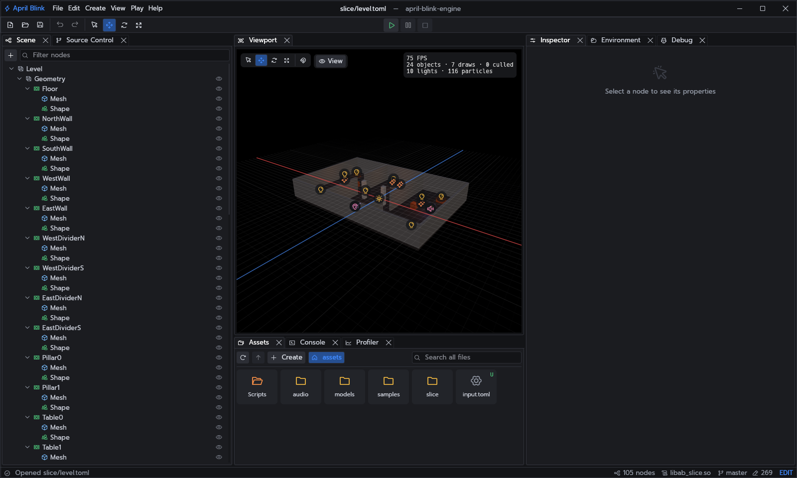
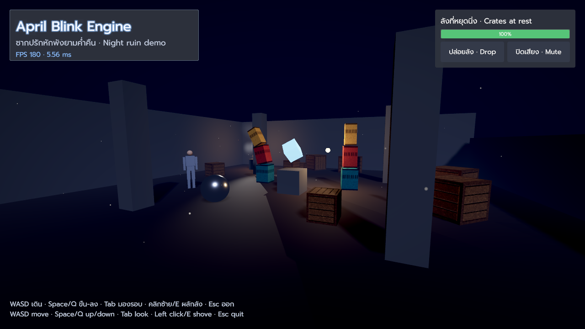
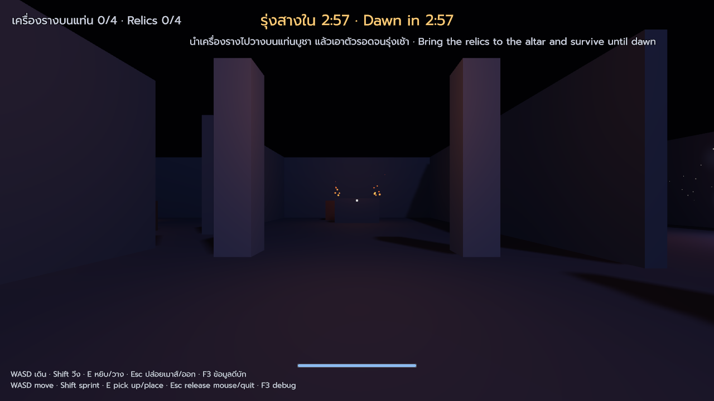
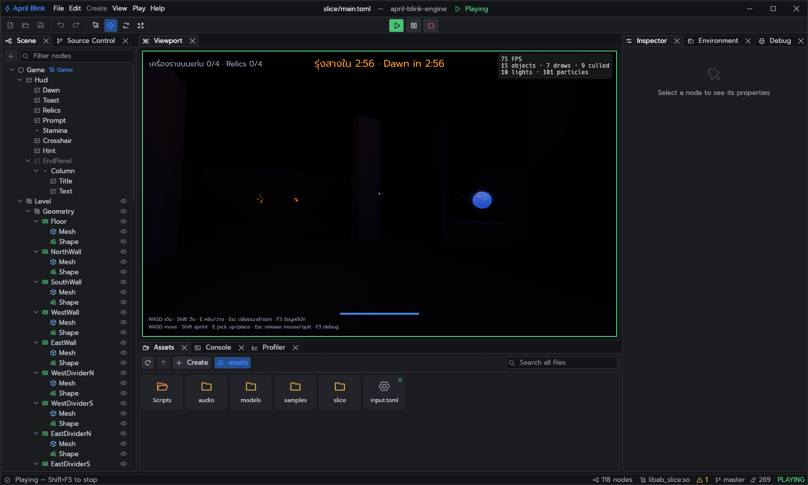

# April Blink Engine

April Blink Engine is a lightweight 3D game engine inspired by Godot, written from scratch in
Rust. It deliberately leaves features out: the goal is a simpler, focused and efficient
foundation for making games, with a small codebase that one person can read and change.

<table>
  <tr>
    <td width="50%"></td>
    <td width="50%"></td>
  </tr>
  <tr>
    <td align="center"><b>The demo</b>: physics, lights, particles, UI</td>
    <td align="center"><b>Night Relics</b>: the vertical slice</td>
  </tr>
</table>

<i>Play in editor: the game runs in the viewport while the scene tree stays live.</i>

## Features

- **Scenes**: a node tree (`Node3D`, physics bodies, lights, cameras, UI controls…) on a
  small sparse-set ECS, with signals, groups, tweens and TOML scene files.
- **Rendering**: a wgpu forward renderer with shadows, bloom, skinned meshes, particles,
  debug lines and MSDF text (complex scripts such as Thai included).
- **Physics**: Rapier 3D bodies, joints, ragdolls, areas, scene queries and a kinematic
  character controller; grid navigation baked from the physics world.
- **Audio**: Kira streams, 2D/3D players and a listener.
- **Editor**: scene editing, play in editor, assets, inspector, console, profiler, source
  control and one-click export.
- **Scripting**: Rust scripts built against the `ab-script` SDK and loaded through a stable
  C ABI, so the editor and games never need rebuilding with them; rebuilt and hot reloaded
  while the game or the editor runs.
- **Shipping**: a prebuilt player plus the game's script library and a single `.abp` asset
  pack, for Linux and Windows; the editor itself ships as a standalone download.

## Requirements

- Rust **1.95** or newer (`rustup update stable`).
- A GPU driver with Vulkan, DX12 or Metal.
- Linux: `libwayland-dev libxkbcommon-dev libudev-dev libasound2-dev` (Debian/Ubuntu names).
- Windows builds from Linux (optional): `cargo install --locked cargo-xwin`, plus `clang` and
  `lld`.

## Workspace

| Crate | Purpose |
| --- | --- |
| `ab-core` | Math (glam), time, identifiers, logging, job pool |
| `ab-ecs` | Minimal sparse-set ECS under the node API |
| `ab-scene` | Godot-style node tree, signals, scene files |
| `ab-platform` | Windowing, OS events, frame pacing (winit), gamepads (gilrs) |
| `ab-input` | Keyboard, mouse and gamepad state with an action map |
| `ab-asset` | glTF 2.0 and PNG/JPEG loading and caching |
| `ab-vfs` | Virtual file system and `.abp` asset packs |
| `ab-rendering` | wgpu forward renderer |
| `ab-animation` | Keyframe clips and playback |
| `ab-physics` | Rapier 3D physics, joints, ragdolls, character controller |
| `ab-navigation` | Grid navigation baked from physics, A* paths |
| `ab-effects` | Particles, one-shot effects, light flashes, camera shake |
| `ab-audio` | Kira audio: streams, 2D/3D players, listener |
| `ab-ui` | Screen-space controls, layout and MSDF text |
| `ab-engine` | Facade: game loop, scheduling, subsystem wiring, script host, hot reload |
| `ab-script-api` | The C ABI between the engine and script libraries |
| `ab-script` | The script SDK game projects depend on |
| `ab-project` | Projects: template, script builds, export, archives |
| `ab-player` | The prebuilt executable exported games run on |
| `ab-editor` | The editor |
| `ab-app`, `ab-demo-scripts` | The demo and its scripts |
| `ab-slice` | Night Relics, the vertical slice |
| `tools/ab-pack` | Creates, inspects and verifies `.abp` packs |
| `xtask` | Project automation (`cargo xtask`) |

## Main dependencies

| Library | Version |
| --- | --- |
| wgpu | 30 |
| winit | 0.30 |
| glam | 0.33 (shared with Rapier and Kira) |
| rapier3d | 0.36 |
| kira | 0.12 |
| eframe / egui | 0.36 (egui_dock 0.21) |
| gltf | 1.4 |
| image | 0.25 |

## License

MIT. See [LICENSE](LICENSE).
